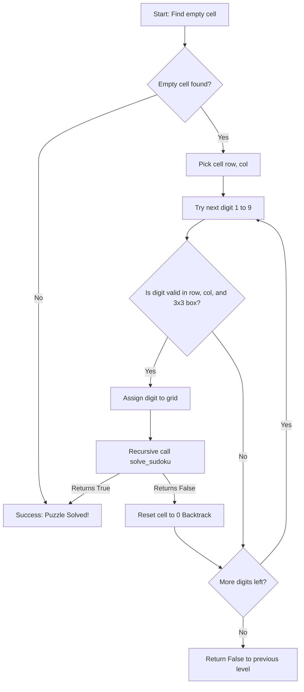

# Problem 3: Basic Sudoku Solver (9x9)

## 1. Problem Statement

Sudoku is a popular logic-based combinatorial number-placement puzzle played on a $9 \times 9$ grid divided into nine $3 \times 3$ subgrids (also called blocks or regions).

The grid begins with several numbers already provided as fixed "clues", while empty cells are represented by `0`.

### Puzzle Rules:
To solve the puzzle, every empty cell must be filled with a digit from `1` to `9` such that:
1. **Row Constraint**: Each of the 9 rows contains all digits from `1` to `9` with no duplicates.
2. **Column Constraint**: Each of the 9 columns contains all digits from `1` to `9` with no duplicates.
3. **Subgrid (Box) Constraint**: Each of the nine $3 \times 3$ subgrids contains all digits from `1` to `9` with no duplicates.

---

## 2. Objective

The Python program aims to:
- Accept a $9 \times 9$ Sudoku grid as input, using `0` to denote empty cells.
- Validate that the input consists of exactly 9 rows and 9 columns with digits between $0$ and $9$.
- Detect and reject invalid initial puzzle configurations (e.g., duplicate clues within the same row, column, or $3 \times 3$ subgrid).
- Solve the puzzle using a depth-first recursive **Backtracking algorithm**.
- Display the initial puzzle and the completed solution using clear ASCII borders with $3 \times 3$ subgrid separators.
- Report gracefully if a puzzle has no mathematical solution.
- Guarantee that original clues are preserved unchanged.

---

## 3. Algorithm Used: Recursive Backtracking

Backtracking is a systematic, depth-first search (DFS) algorithmic technique for solving constraint satisfaction problems (CSPs).

### How Backtracking Works:
1. **Find Unassigned Cell**: Search the grid from top-left to bottom-right for the next empty cell (`0`).
   - If no empty cells remain, the puzzle is solved (**Base Case**).
2. **Try Candidate Digits**: For the selected cell, iterate through digits $1$ through $9$.
3. **Check Constraints (`is_valid`)**: Check if placing candidate digit $d$ violates row, column, or $3 \times 3$ box rules.
4. **Tentative Assignment & Recursion**:
   - If legal, tentatively assign $d$ to the cell.
   - Recursively call `solve_sudoku(grid)` to solve the rest of the board.
   - If the recursive call returns `True`, propagate success upward.
5. **Backtrack (Undo Assignment)**:
   - If the recursive call fails (returns `False`), it means placing digit $d$ leads to an unsolvable state later down the tree.
   - Reset the cell back to `0` and try the next candidate digit.
6. **Failure**: If all digits from $1$ to $9$ are exhausted without finding a valid placement, return `False` to back up to the previous cell.



---

## 4. Approach and Implementation

### Grid Data Structure
The $9 \times 9$ board is represented as a list of 9 lists, where each inner list contains 9 integers:
```python
grid: List[List[int]]
```
Empty cells are represented exclusively by `0`.

### Helper Functions

1. **`print_grid(grid)`**:
   Renders the board with horizontal dividers (`+-------+-------+-------+`) and vertical bars (`|`), showing digits $1$–$9$ and representing empty cells with dots (`.`) for clarity.

2. **`find_empty_cell(grid)`**:
   Iterates through row index $r \in [0, 8]$ and column index $c \in [0, 8]$. Returns the first coordinate `(r, c)` where `grid[r][c] == 0`. Returns `None` if the board is completely filled.

3. **`is_valid(grid, row, col, num)`**:
   Validates all 3 constraints for digit `num`:
   - **Row check**: `grid[row][c] == num` for $c \in [0, 8]$ ($c \ne col$).
   - **Column check**: `grid[r][col] == num` for $r \in [0, 8]$ ($r \ne row$).
   - **Subgrid check**:
     $$\text{start\_row} = (\text{row} // 3) \times 3, \quad \text{start\_col} = (\text{col} // 3) \times 3$$
     Checks all cells in the $3 \times 3$ block from `(start_row, start_col)` to `(start_row + 2, start_col + 2)`.

4. **`validate_initial_grid(grid)`**:
   Ensures the grid has $9 \times 9$ dimensions, all values are in $[0, 9]$, and that no initial clues clash with each other.

5. **`solve_sudoku(grid)`**:
   Executes the recursive backtracking procedure in-place.

---

## 5. How to Run

Navigate to the `Problem 3` directory and execute:

### Interactive Menu Mode:
```bash
python sudoku_solver.py
```
You will be prompted with three options:
- **Option 1 (Default)**: Automatically solves a built-in classic Sudoku puzzle (press **Enter** for quick testing).
- **Option 2**: Enter your own custom puzzle row-by-row.
- **Option 3**: Test an unsolvable puzzle to observe how unsolvability is handled.

### Command-Line Arguments Mode:
You can also run directly without prompts:
```bash
python sudoku_solver.py --sample
python sudoku_solver.py --unsolvable
```

---

## 6. Sample Input

When selecting Option 2, rows can be entered either space-separated (`5 3 0 0 7 0 0 0 0`) or as continuous 9-digit strings:

```text
Row 1: 5 3 0 0 7 0 0 0 0
Row 2: 6 0 0 1 9 5 0 0 0
Row 3: 0 9 8 0 0 0 0 6 0
Row 4: 8 0 0 0 6 0 0 0 3
Row 5: 4 0 0 8 0 3 0 0 1
Row 6: 7 0 0 0 2 0 0 0 6
Row 7: 0 6 0 0 0 0 2 8 0
Row 8: 0 0 0 4 1 9 0 0 5
Row 9: 0 0 0 0 8 0 0 7 9
```

---

## 7. Sample Output

### Solvable Puzzle Execution:
```text
--- INITIAL SUDOKU PUZZLE ---
+-------+-------+-------+
| 5 3 . | . 7 . | . . . | 
| 6 . . | 1 9 5 | . . . | 
| . 9 8 | . . . | . 6 . | 
+-------+-------+-------+
| 8 . . | . 6 . | . . 3 | 
| 4 . . | 8 . 3 | . . 1 | 
| 7 . . | . 2 . | . . 6 | 
+-------+-------+-------+
| . 6 . | . . . | 2 8 . | 
| . . . | 4 1 9 | . . 5 | 
| . . . | . 8 . | . 7 9 | 
+-------+-------+-------+

Solving puzzle using Backtracking Search...

--- SOLVED SUDOKU PUZZLE ---
+-------+-------+-------+
| 5 3 4 | 6 7 8 | 9 1 2 | 
| 6 7 2 | 1 9 5 | 3 4 8 | 
| 1 9 8 | 3 4 2 | 5 6 7 | 
+-------+-------+-------+
| 8 5 9 | 7 6 1 | 4 2 3 | 
| 4 2 6 | 8 5 3 | 7 9 1 | 
| 7 1 3 | 9 2 4 | 8 5 6 | 
+-------+-------+-------+
| 9 6 1 | 5 3 7 | 2 8 4 | 
| 2 8 7 | 4 1 9 | 6 3 5 | 
| 3 4 5 | 2 8 6 | 1 7 9 | 
+-------+-------+-------+

SUCCESS: Puzzle solved successfully! All constraints satisfied.
```

### Unsolvable Puzzle Execution:
```text
Solving puzzle using Backtracking Search...

!!!!!!!!!!!!!!!!!!!!!!!!!!!!!!!!!!!!!!!!!!!!!!!!!!!!!!!!!!!!
NO SOLUTION FOUND: This Sudoku puzzle cannot be solved.
!!!!!!!!!!!!!!!!!!!!!!!!!!!!!!!!!!!!!!!!!!!!!!!!!!!!!!!!!!!!
```

### Invalid Initial Input Execution (Conflicting Clues):
```text
!!!!!!!!!!!!!!!!!!!!!!!!!!!!!!!!!!!!!!!!!!!!!!!!!!!!!!!!!!!!
INVALID PUZZLE INPUT:
Error: Initial clue conflict: digit 5 at Row 1, Col 1 violates Sudoku rules.
!!!!!!!!!!!!!!!!!!!!!!!!!!!!!!!!!!!!!!!!!!!!!!!!!!!!!!!!!!!!
```

---

## 8. Code Explanation

- **Modifying In-Place**: The grid is modified directly in memory during recursion, avoiding deep-copy overhead at each step. If a branch fails, resetting `grid[row][col] = 0` restores the board state before returning to the caller.
- **Subgrid Index Arithmetic**: Finding the top-left cell of a $3 \times 3$ box uses integer division: `(row // 3) * 3`. For example, row index $4$ gives $(4 // 3) \times 3 = 1 \times 3 = 3$, meaning rows $3, 4, 5$ belong to that middle box.
- **Clue Preservation Check**: Before solving, a deep copy of the original clues (`original_puzzle`) is saved. After solving, an assertion verifies that every cell that was non-zero in the original puzzle remains unchanged.

---

## 9. Time and Space Complexity

- **Time Complexity**: $\mathcal{O}(9^{M})$ where $M$ is the number of empty cells (at most $81$).
  In the worst case, every empty cell has up to 9 possible candidate values. However, constraint checking (`is_valid`) prunes the vast majority of invalid branches very early, making typical puzzles solve in less than $0.1$ seconds.
- **Space Complexity**: $\mathcal{O}(M)$ auxiliary space.
  The maximum depth of the recursion tree equals the number of empty cells $M \le 81$. The board itself takes $\mathcal{O}(9 \times 9) = \mathcal{O}(1)$ space.

---

## 10. Viva Preparation

### Q1: What is Backtracking and how does it apply to Sudoku?
**Answer**: Backtracking is an algorithmic approach that systematically builds candidate solutions incrementally. If an assignment violates any constraint or fails to lead to a complete solution, the algorithm backtracks by undoing the most recent choice (`grid[r][c] = 0`) and trying the next available candidate.

### Q2: What are the three constraints checked in `is_valid()`?
**Answer**:
1. **Row constraint**: The number must not already exist in the target row.
2. **Column constraint**: The number must not already exist in the target column.
3. **$3 \times 3$ Subgrid constraint**: The number must not already exist in the $3 \times 3$ box enclosing that cell.

### Q3: How do you identify which $3 \times 3$ box a cell `(r, c)` belongs to?
**Answer**: By using integer division:
$$\text{start\_row} = (r // 3) \times 3, \quad \text{start\_col} = (c // 3) \times 3$$
This gives the top-left coordinate of the subgrid, and we check coordinates from `start_row` to `start_row + 2` and `start_col` to `start_col + 2`.

### Q4: Why is DFS / Backtracking preferred over BFS for Sudoku?
**Answer**: A BFS queue for Sudoku would store an exponential number of partially filled boards at each layer ($9^1, 9^2, 9^3, \dots$), exhausting system memory almost immediately. Backtracking uses DFS recursion with negligible call stack memory ($O(81)$), modifying a single grid in-place.

### Q5: What happens when an entered Sudoku puzzle has no solution?
**Answer**: The recursive backtracking explores all legal combinations. When every path exhausts its candidate digits without filling the board, `solve_sudoku()` returns `False`, and the program displays a clear message that no solution exists.
